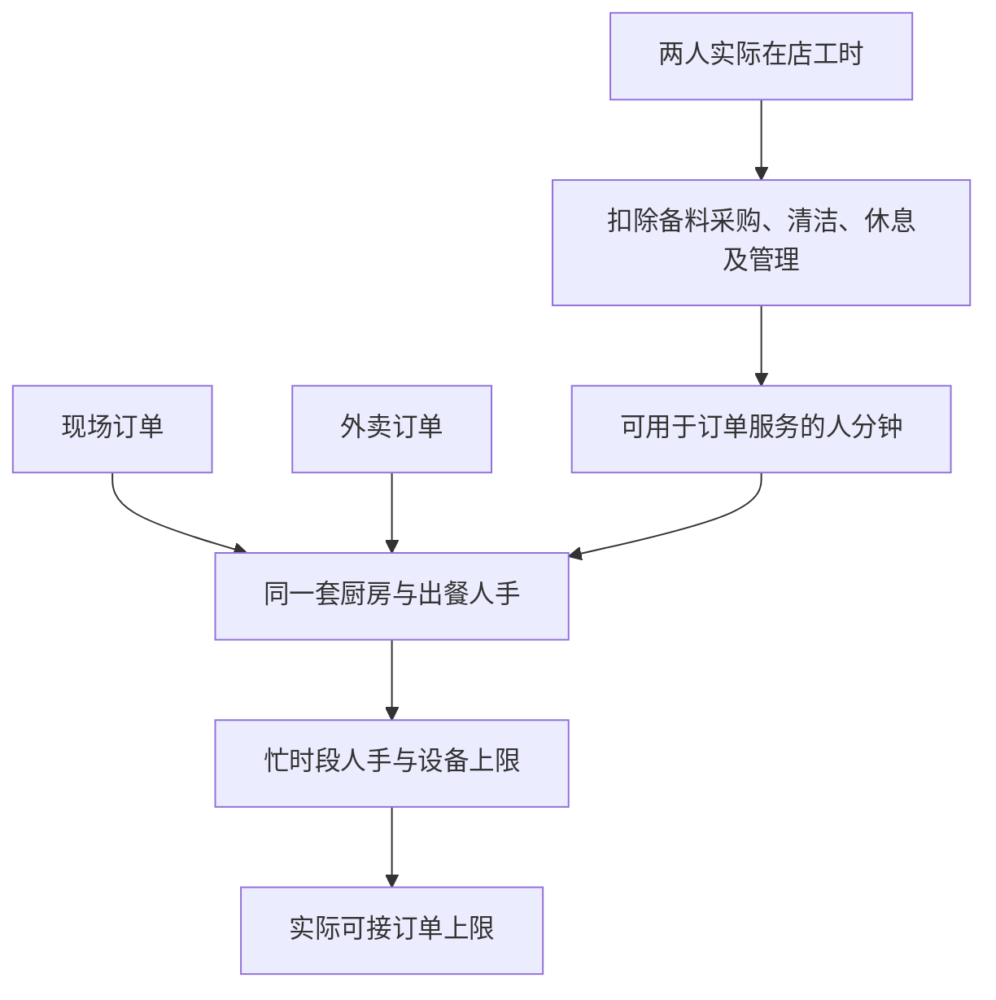

# 两位合伙人够不够用？——人手、出餐能力与招聘成本（V3）

研究日期：2026-11-27。适用范围：深圳宝安福海、新和周边的小型早餐、轻食、零食及简餐经营情景。**老板工资不计入成本，两位合伙人各自投入实际工作时间；超过两人实际能力时必须配人或缩小经营规模。**

## 1. 深圳餐饮招人，一般要准备多少钱？

招聘网站的工资是雇主**挂牌**，既不是签订劳动合同后的实际薪资，也不是当地平均工资。以下来自截至调研日公开索引，实际招聘状态、具体工作时间、加班费、社保与住宿条件需要与雇主确认。动态列表刷新后可能不再展示原岗位，故保留样本的公开索引日期、条目及可复核链接，不将其伪装成已经谈定的工价。未取得本商圈店员样本的完整工时和工资单。

| 地域与公开岗位 | 挂牌月薪/时薪 | 福利、工作要求或边界 | 来源 |
|---|---:|---|---|
| 福海和平社区餐饮店：汉堡店员（炣沩餐饮店） | 4,000–5,000元/月 | 包住、餐补；2026-11-24招聘索引 | L01 |
| 福海苍井寿司店：店员 | 4,000–5,000元/月 | 全职、月结、包吃及培训；索引近3周 | L02 |
| 福海李师傅食为天快餐店：自选快餐炒菜厨师 | 8,000–9,000元/月 | 全职、包吃住；索引近1个月 | L03 |
| 宝安东华旺饮食店：外卖出餐、打包、接单 | 4,000元/月 | 包吃；公开索引文字，近1周 | L04 |
| 宝安煲仔饭配菜／打荷 | 4,000–5,000元/月 | 招工广告注明包吃住、社保；公开招聘页 | L05 |
| 宝安吉源餐饮：后厨制作、打包 | 4,000–5,000元/月 | 包吃；2026-08-13岗位索引 | L06 |
| 宝安朱家小吃店：早餐厨师 | 3,500–4,000元/月 | 包吃；58同城公开索引，调研日更新 | L07 |
| 宝安新桥德旺兴现炒店：早餐厨师 | 3,000–5,100元/月 | 招聘称工作时间灵活，具体工时不明 | L07 |
| 宝安弘毅餐饮：小吃/快餐店厨师 | 4,500–6,000元/月 | 包吃，工作餐 | L07 |
| 宝安赣小厨餐饮店：厨师 | 7,500–8,000元/月 | 包吃包住 | L07 |
| 宝安潮禾膳餐饮店：炒锅/烧腊/卤味厨师 | 6,500–7,000元/月 | 五险及包吃住，3–5年经验 | L07 |
| 深圳龙华肠粉周末帮手：跨区时薪样本 | 25元/小时 | 2026-11-27挂牌日，低于深圳新时薪标准；不可照搬该报价 | L08 |

**结论：** 增聘熟练普通店员的挂牌工资，以4,000–6,000元/月作为建模范围；做多时段炒菜，若合伙人不具备厨师能力，专业厨师通常要单独定价。早餐厨师的低薪挂牌不代表工时不同情况下仍能招到人。全职工资不等于老板的全部支出。

## 2. 同样是5,000元工资，门店实际要花多少钱？

| 一个普通全职新增人员（元/月） | 低 | 中 | 高 |
|---|---:|---:|---:|
| 挂牌参考税前工资 | 4,000 | 5,000 | 6,000 |
| 单位社保、公积金等支出预留 | 1,250 | 1,600 | 1,950 |
| 餐住、轮休顶岗等预留 | 550 | 600 | 850 |
| **每月新增完整预算** | **5,800** | **7,200** | **8,800** |

上述加成是**经营预算预留**，不是政府收费报价，也不是法律规定的统一单位金额。实际单位支出取决于雇员社保类别、缴费基数、工伤费率、是否另供食宿、实际班次与加班费。若加班/住宿/替班费用超出预留，增加现金支出，不允许以压低工资或不参保来补齐利润。2026年9月1日起，深圳正式执行月最低工资2,700元和非全日制小时最低工资25.4元。广东企业职工养老保险2026年7月起缴费基数下限5,521元、上限27,603元，深圳住房公积金单位与个人缴存均按各自5%–12%的规定区间选择，说明不能直接把低薪乘一个任意低比例。[L09–L11] 例如月税前工资5,000元：单位养老最低基数5,521元×16%≈883元（深户另计1%地方补充养老约55元）；2026年职工医保最低基数6,727元，单位一档6%约404元，二档1.5%约101元；单位公积金若基数为5,000元、比例5%，约250元。仅上述三项已约1,234–1,592元（含户籍差异），另外还有生育、失业与工伤保险等。故基准用1,600元预留、低档用1,250元只是预算假设，并非任何身份皆适用；若实际法定费用超过模型预留，直接上调至实际成本。低档在允许的医保档次和适用缴费情形下才可能达到，不能为了降成本自行选错档次。[L14–L16]

- 如没有人懂专业热厨，D类多时段需要额外的专业厨师：挂牌税前8,000–9,000元，完整预算约10,800–12,500元/月（中位11,600元），对利润单独做敏感性评估。普通人员与厨师不要重复计聘；若某厨师替代普通员工，做工资差额敏感性即可。
- 如只有繁忙时段缺人，可测短班帮手；计每小时工资30元、单位用工成本完整预算35元/小时为中位假设，3小时×26天×35＝2,730元/月。非全日制规则一般每天不超过4小时、每周累计不超过24小时；合法计薪、工伤保障、支付周期和具体用工关系另行核实。该成本只购买短班人手，不等同于全天285分钟的服务能力。[L09,L12]
- 两位合伙人工资＝0（按用户指定口径），合伙人的投资、分红、生活费或自行安排的社保不是聘用人员工资，必须与门店现金流的个人提款分开处理。两人如果都不能长期撑下去，即使账面利润是正数，经营模式仍可能难以维持。

**可视化表达建议：** 手机报告用三层卡片呈现：一个普通员工的「5,000元工资」＋「1,600元单位用工预留」＋「600元餐住/轮班」＝「7,200元/月门店成本」。标明高低区间与“预算假设”。

## 3. 产能不是总营业时长，而是能够真正处理订单的时间

每天计划忙26天/月。按两位合伙人每日同时或交错工作计算，避免把两人都当无限工时。下表的“直接服务分钟”含单件主动制作/组装、收款、备订单、交付与短时清理，已从总工时扣除大批次准备、管理、盘货、清洁和吃饭休息，故不再额外叠加同一批次人时。设备在被动加热、冷却等阶段不等于一直占用人手，但必须受其独立吞吐上限约束。

| 模式 | 每位合伙人每天计划在店工时 | 两人合计实际服务分钟/日 | 合计固定工作及休息分钟/日 | 两人月累计在店工时/人 |
|---|---:|---:|---:|---:|
| A 传统中式早餐 | 8.5小时 | 700 | 320 | 221小时 |
| B 便携特色早餐 | 8.5小时 | 680 | 340 | 221小时 |
| C 早餐+社区零食 | 9小时 | 720 | 360 | 234小时 |
| D 多时段早餐简餐 | 10小时 | 690 | 510 | 260小时 |
| E 分时合作档口 | 6.5小时 | 480 | 300 | 169小时 |

D尤其依赖长时间经营且需要有合格厨师。若全日营业跨度大于两位合伙人的交错覆盖范围，须另排班；不能假设同一个人上午卖早餐、下午全时加工、晚上出餐都不会累。D的日成本模型应结合营业天数、实际休息和新增员工；若需要全年不断营业，至少安排休班覆盖，不可只用26天平均掩盖特定日期缺人。E的时间窗口受分时协议限制，即使模型显示增聘一位全天员工可提高理论产能，也不代表合作方允许其工作8小时；短班可能更匹配，必须取得实际可用时段。

### 订单是如何占用人手的？（每单主动操作时间的估计）

以下是**模型工程估计**，非本地实际测量：每单服务时间按混合菜单订单而不是一件商品，订单中如果商品数量更多、制作更复杂，需重设参数；外卖包装、核对、骑手交接等时间已包含在外卖单内。可用门店试营业计时替换。

| 模式 | 现场订单分解（分钟） | 现场总计 | 外卖订单额外（分钟） | 外卖总计 |
|---|---|---:|---:|---:|
| A | 取/加工1.15＋收款0.45＋装袋0.60 | 2.20 | 包装及核对0.80 | 3.00 |
| B | 组装压烤1.45＋收款0.45＋装袋0.70 | 2.60 | 包装核单0.80 | 3.40 |
| C | 取商品或套餐0.90＋收款0.50＋包装0.60 | 2.00 | 包装、SKU核对1.10 | 3.10 |
| D | 现制或配菜2.05＋收款0.45＋装盘装袋1.10 | 3.60 | 包装、多菜品核单1.20 | 4.80 |
| E | 取/加热1.10＋收款0.45＋装袋0.55 | 2.10 | 包装核对及受限交接1.10 | 3.20 |

现场分解和外卖增量是等效主动所需工时，非每单真实等待时长（出餐可能受设备和积单影响更久，外卖支付环节可能被平台系统替代）。低产能测试把每单时间×1.20、可用工时×0.90；高产能测试把每单时间×0.85、可用工时×1.08，但高产能仍不得超设备、卫生、场所及排班限制。

## 4. 生意最忙的时候，先看高峰能处理多少单

不是同一天上午、下午所有时间都可以调到繁忙时段。全天和繁忙时段两条限制同时作用。以下高峰时长为全日聚合繁忙阶段的建模值，不是特定学校实际上下学时刻。实际每段高峰份额和各渠道订单到达时序需由试营业确认。

| 人手安排 | A/B：150分钟 | C：160分钟 | D：180分钟 | E：135分钟 |
|---|---:|---:|---:|---:|
| 两位合伙人有效高峰服务分钟 | 234 | 250 | 270 | 211 |
| 新增一名全职员工平均高峰服务分钟 | 89 | 95 | 107 | 80 |
| 全日订单集中在繁忙时段的假设 | A62% / B58% | 50% | 48% | 68% |

新增1名员工的名义8小时×每月20.67工作日，与门店开26天不一样。按同比例配排班及75%有效服务系数，平均每天新增约285分钟；不是每天保证有480分钟可用。2025年人社部通知明确，20.67天是月平均制度工作日，21.75天用于日工资及小时工资折算；两者不可混用。[L13] 如某天员工不在，应用当天实际在岗人数重新核算并限制接单。额外人员可在需求稳定后再按经济性增聘。

### 一个例子：A传统早餐，有25%的订单来自外卖

1. 现场订单占75%、外卖占25%：平均一个订单需2.2×75%＋3×25%＝2.4人分钟。
2. 全天产能：700÷2.4≈291单。
3. 高峰产能：234÷(62%×2.4)≈157单（因为约62%订单挤在繁忙时段）。
4. 假设设备可处理390单/日（30㎡中档配置，非已买设备的实测参数），**这时最先碰到的是人手高峰限制：157单，而不是291单或390单。**
5. 加一名普通员工，平均高峰增89分钟：323÷(62%×2.4)≈217单。理论增加60单/天；若只剩20单未满足需求，则实际新增不超过20单。假如每单新增净贡献3元（仅举例），26天×20单×3元＝1,560元，低于完整工资7,200元；贸然请长工可能反而亏。按同样净贡献，至少须稳定新增93单/天才覆盖7,200元，且该60单/天的理论新增能力也不够。另一项可选对照是合法短班、简化菜单、按峰时段控制平台营业、增大瓶颈设备或减少营业日，不表示必然更优。

**公式：实际服务订单 = min（顾客需求、全天人手上限、高峰人手上限、设备/空间上限）。**

到店和线上订单共享厨房、包装、取餐人手：不允许把到店的157单与线上另一套上限相加。若两渠道在不同时间段更集中，用每个渠道真实到达时段分别计入对应窗口，取更紧的瓶颈。部分模式可售仅预包装零食，处理时间可能低于这里，须根据产品组合重新加权。

| 模式与中档面积 | 两位合伙人、只做现场单/day | 两位合伙人、外卖25%/day | 新增1名全职、外卖25%/day | 设备中档理论上限/day |
|---|---:|---:|---:|---:|
| A 30㎡ | 171 | 157 | 217 | 390 |
| B 28㎡ | 155 | 144 | 198 | 360 |
| C 45㎡ | 250 | 219 | 303 | 420 |
| D 70㎡ | 156 | 144 | 201 | 420 |
| E 12㎡（共享可用区） | 147 | 130 | 180 | 250 |

全部是**模型示例上限**，不是销量预测；高峰份额影响极大。面积低/中/高对应的设备理论上限：A 260/390/550，B 220/360/500，C 280/420/550，D 220/420/600，E 160/250/340；与成本模块配置对照、不能替代设备批量测试。空间配置最多新增全职人员 A/B/C 1/2/3、D 1/3/5、E 0/1/1，仅用于避免假设小铺无限堆人；所有上限须经实际工位、安全通道和合同验证。

## 5. 经营流程还要配得上实际技能

| 模式 | 两位合伙人如何分工（可交换） | 何时出现新增人手或技能缺口 |
|---|---|---|
| A | 一人批量制备、蒸制和补货；一人收款与装袋 | 出餐窗口拥堵、蒸柜及补货、人手交接 |
| B | 一人冷热分区组装压烤；一人接单、包装及核对 | 现制SKU太多、组装耗时、包装和骑手交接 |
| C | 一人热食准备补货；一人收款陈列及库存管理 | 长时段看店、订单与补货冲突，临期报损跟不上 |
| D | 一人热厨；另一人订单、前台及洗消 | 两位中没有熟练厨师、不同饭点交错、工作跨度太长；专业厨师或分班人员必要 |
| E | 一人少品类加工，一人收银、打包、交接 | 空间及使用时间限制，不一定允许加人；短班对照需合同验证 |

门店能够处理更多订单前，先确认操作区分隔、洗消、过敏原、备料和库存；不得通过压缩必要食安流程获取虚假高产能。若没有接单能力则先限制新接订单或平台服务范围，不把未来销量直接推高。

## 6. 到店实测方案：用一张表验证假设，不需要猜

- 采集至少40笔模拟或合法试营业订单；每类菜单抽10–20笔为宜，分别测现场、外卖、混合订单，记录从接单到交付的总等待时间、每工位主动时间、批次设备情况和误餐/漏餐率。个人姓名、未成年人轨迹并非开店产能所需数据，不采集。
- 测三组负载：约30%、60%、90%预计繁忙度；模拟另一名合伙人忙着补货、员工休假和配送同时到店。记录食安/清洁是否能按规定完成、累积队列，缺口出现时暂停接单。
- 先测现场和外卖的实际混合比例，以及每15分钟匿名总订单数和高峰集中度。用全天数据与分时段分布重算，不用学校个人出行数据替代实际订单。
- 用真实招聘沟通或正规渠道询价（各角色2–3份以上），确认工资构成、社保、吃住、轮休、工作地点和岗位技能；更新区间而非只记一个漂亮价格。
- 两位合伙人同步填一周值班与休息表，核对配送、采购、清洁、营销、报税、记账及生病替班；人员离店仍需有人负责食品安全。以后每周复测订单时长和等待时间。

## 来源与证据状态

- L01 鱼泡直聘，深圳宝安区炣沩餐饮店企业/招聘公开索引：https://m.yupao.com/qiye/226854625.html 。当前企业页面可核实经营主体位置，招聘岗位标题/费用来自2026-11-27检索快照；刷新后招聘内容不固定，不是签约记录。
- L02 鱼泡直聘，福海苍井寿司店招聘公开列表快照（索引近3周）：https://www.yupao.com/s/yp9358276/ 。列表刷新不能确保逐条长期保留。
- L03 鱼泡直聘，福海食为天快餐店厨师公开列表快照：https://www.yupao.com/s/yp3489552/ 及 https://m.yupao.com/s/yp4672285/ 。岗位相关搜索索引近1个月；现仍否招聘待核实。
- L04 鱼泡直聘，宝安东华旺饮食店出餐打包公开列表快照：https://www.yupao.com/s/yp4445634/ （近1周索引）。
- L05 鱼泡直聘，宝安煲仔饭配菜打荷招聘页面索引：https://www.yupao.com/zhaogong/522066995.html 。后续直达链接未稳定打开，降为搜索快照证据。
- L06 鱼泡直聘，宝安吉源餐饮后厨和打包招聘索引：https://m.yupao.com/zhaogong/440667525.html 。后续直达未稳定打开，降为搜索快照证据。
- L07 58同城，深圳厨师招聘列表，调研日公开搜索快照：https://www.58.com/ppeseoll30587/ 。挂牌样本来自该列表，实际岗位页需要正常进入平台核实；不认定全部岗位仍招人。
- L08 鱼泡直聘，跨区时薪参照，仅用于识别不合理报价：https://m.yupao.com/zhaogong/522358234.html 。
- L09 深圳市人力资源和社会保障局，2026最低工资标准调整，2026-09-01生效：https://hrss.sz.gov.cn/tzgg/content/post_12954870.html 。
- L10 广东省人社厅等，粤人社发〔2026〕24号，养老缴费上下限，2026-10-08公布：https://hrss.gd.gov.cn/zwgk/gsgg/content/post_4957552.html 。
- L11 深圳市住建局公积金缴存区间，2026-03-26：https://zjj.sz.gov.cn/hdjl/ywzs/content/post_12703756.html ；2026公积金年度官方答复：https://www.sz.gov.cn/hdjlpt/detail?pid=3463076&via=pc 。
- L12 《中华人民共和国劳动合同法》第68–72条关于非全日制用工：https://www.samr.gov.cn/zw/zfxxgk/fdzdgknr/bgt/art/2023/art_0abfdd261c03417b949df19d869add8d.html-0 。
- L13 人社部职工全年月平均工作时间和工资折算通知，2025-01-01：https://app.www.gov.cn/govdata/gov/202501/02/523227/article.html 。

- L14 广东及深圳税务部门、人社厅2025起企业养老单位缴费比例16%：https://guangdong.chinatax.gov.cn/gdsw/tzgg/2024-12/30/content_ae1e88d7f7b749caadd63a777b54bd8f.shtml ；深圳人社局深户补充养老1%答复：https://www.sz.gov.cn/hdjlpt/detail?pid=3072960 。
- L15 深圳医保局2026年度医疗、生育基数及费率恢复通知，2025-12-25：https://hsa.sz.gov.cn/gkmlpt/content/12/12567/post_12567884.html 。
- L16 深圳《医疗保障办法》，政府令第358号（按适用类别参保及单位费率）：https://www.sz.gov.cn/zfgb/2023/gb1305/content/post_10865658.html 。

### 调研状态与迭代

查证：官方最低工资、养老缴费基数、公积金比例、非全日制工时、法定折算；鱼泡与58同城岗薪样本作为市场线索；BOSS直聘可见搜索索引但直接打开遇安全验证，未绕过，未使用其数值。招聘平台暂未获得本商圈完整真实薪资样本。门店具体工位计时、配送骑手峰值、设备功耗和实际班表未实测，全部清晰留为可替换的估计。若授权客户端可正常登录平台，补齐岗位详情、招聘时间和福利，然后重新计算工资预算和各模式产能。

机器可读参数：`v3/evidence/labor_capacity.json`。建模时应读取该文件，并以实际工资、实际菜单和轮休排班更新；不要直接把样本报价当成营业成本。
