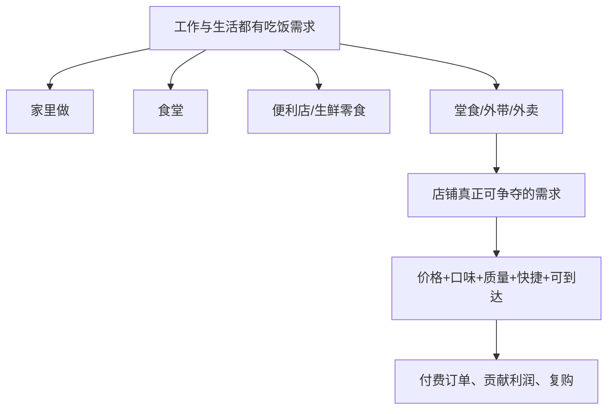

# V4 客群、产品、替代竞争、双合伙人经营判断

**调研日期：2026-11-27。** 本章重新检索并读到原文，重点纠正上一版把“学校、企业、人气”当成潜在客流的风险。研究范围：新和社区本地；福海街道其他园区、宝安其他街道、深圳其他城区分别标明。所有价格为报道当日价签或明确的待试营业假设；均不是新和当前平台菜单及完整市场普查。证据编号及结构化数据见 [customer_product_v4.json](../evidence/customer_product_v4.json)。

## 1｜读者先知道的 4 件事（V4 新增，不是重抄 V3）

1. **福新小学 2026 年预算已出现“学生自营食堂开支”。** 旧目录写配餐；最新预算要求修正对实际替代供给的理解。仍不知道是否提供早餐、多少人参与、现时总人数等，不能将旧的 36 班、1798 人当现时客流。[CP01]
2. **工业园的客人并非必然来街边吃。** 新和本地一家制造企业的 2024 年外部温室气体核查报告确认有外包食堂；福海其他工业园报道过 500 餐位、午餐挂牌 10/12/14 元的公共食堂。社区附近存在不可忽视的内部供给，午餐扩张须实测。[CP03][CP04]
3. **特色早餐和零食也有大型替代者。** 记者 2026 年 10 月实访深圳 7-Eleven 门店：部分大口饭团 7.5 元，主食+饮品 12.9/14.9 元；2026 年 1 月宝安福永福围的新融合店将生鲜与千款零食并置。说明组合业态真实存在，同时会争夺 C 型店的消费。不证明新和同价，也不证明那些店盈利。[CP07][CP08]
4. **规划、共享、租赁期限是现金风险而非抽象合规词。** 新和社区 2026 年 11 月公开过土地整备单元规划研究招标，后续第三方镜像写采购失败，具体地块/原合同状态须确认；深圳市监管咨询曾明确仅预包装食品备案同址仅一家经营主体。低成本 E 共享经营不等于可以共用他人执照、随时开业。[CP15][CP16][CP12]

---

## 2｜两所学校：当前可证实什么

| 证据 | 福新小学 | 鹏晖中英文学校 |
|---|---|---|
| 性质 | 公办小学；2026年预算再次确认。[CP01] | 民办、九年一贯制（小学及初中），官方旧目录。[CP02] |
| 食堂/供餐 | 旧目录为配餐；2026年预算含“学生自营食堂开支”，伙食费纳入统一预算；午餐午休管理费133万元、课后服务96万元。[CP01] | 官方旧目录为堂食；2025-11-28官方招聘名录再次出现该校。现在早餐及供餐人数不详。[CP02][CP10] |
| 真实数量 | 2026年预算说明学生和教职工人数有所增长，但未公开当前具体人数。2022年的1798人是历史资料。 | 2026当前办学人数无法核实。 |
| 收入及购买意愿 | 学校身份/收费不是家庭收入、零花钱或外购比例代理。 | 同左。 |

**注意：** 预算的590.36万元是“一般管理事务经费”，包含日常事务与自营食堂开支，并非食堂专用成本、售价、饭量或该校早餐消费额。133万元是午餐午休的管理经费、不是餐费。学校供给意味着存在替代，不证明早餐已提供。

两校机构层面的公开身份与供给信息只用于一般商圈替代分析；不推断校内外未成年人个人移动、时间点、群体路线、门口的可利用流量。家庭消费请通过成年购买者自愿、匿名的总体样本与实际付费试营业验证。不能把当地在校人数乘随意转化率来获得营业额。

## 3｜这里的客群，真正争夺的是同一顿饭

**新版叙述地图（非地理路线图）：**

### 3.1 证据从街道规模落到供给冲突

- 作为背景复用官方福海街道概况：约31.8平方公里、7社区、管理人口约53万，其中户籍约6.1万，2025规上工业总产值1805亿元、工矿商贸企业4500余家。[CP17] 这是区域与产业规模，不能当成消费人数，也不能用面积/人口均摊法推断铺面流量。现时新和社区家庭收入、人数分布和生活成本没有经核实数据。
- **本地实证**：深圳坤拓流体技术股份有限公司（新和社区）的2024组织温室气体核查覆盖生产、办公及生活区，披露企业食堂外包、能耗由经营方单独结算。[CP03] 意义是园区内供给确实存在；没有员工实际用餐率、对外权限或菜单，不能把这个个案泛化成所有园区。
- **福海同街道对照（2025-05-08）**：
  - 中粮（福安）机器人科技园：26家企业、3500余员工、健康大食堂500餐位；记者所见价格为1荤1素10元、2荤1素12元、3荤1素14元。[CP04]
  - 福安智造产业园惠民大食堂：200餐位；立新湖创意园食堂300；中晟会港湾便民食堂300；瀚宇湾区创新港工会大食堂800。同一报道2025年5月还提及拟建设5个公共食堂。[CP04]
  - 这些不是完整在营列表，餐位是容量不是日订单；不把拟建项目当2026已营业。园区的对外营业条件、午餐实际销量及补贴未知。
  - **对 D 全时段简餐：在16元客单假设之外，加测12–14元的竞争压力，同时不假定原料等成本同步下降。只有午间新增贡献超过额外人力和设备成本，才有扩张依据。**
- 福海街道新田、塘尾、展城等社区有深圳民政官方公示长者饭堂/助餐点，名单含福安长者饭堂、欢筷、华强城、会展湾东城。[CP05] 对老龄住户可提供适量、清楚标价、方便反馈的餐食；饭堂不是已取得合作关系，长者人数和实际用餐/补贴未知。

### 3.2 成人外食需求也会变化——新调查证据

2026-03-19《卫生研究》发表城市成年居民早餐横断面研究，2021年7—8月通过微信/群网络问卷收集31省18–60岁城市居民共11,162人。[CP06]

| 该研究指标 | 分母 N=11,162 | 百分比 |
|---|---:|---:|
| 5个工作日每天吃早餐 | 9,089 | 81.4% |
| 2个休息日每天吃早餐 | 7,821 | 70.1% |
| 差值（百分点） | — | 11.3 |

**这衡量吃早餐频率，不是外购频率、不是购买力、不是深圳样本、也不是新和成交率。** 网络便利抽样与调查年份是限制。它支持独立测试工作日和休息日需求、而非据此调整当地模型百分比。

复用前版有价值的全国学校营养调查作为替代证据：2019–2021年14省52,535名6–17岁样本主要早餐地点家中66.3%、学校25.8%、其他外部餐饮7.9%，见 [旧研究M11](../../research/01_market.md)。三值只可解释一般供给替代，不能直接套用新和诸校、不能用来估算学生外购。

### 3.3 成年购买场景矩阵（业务假设，非当地调研比例）

| 谁有用餐任务 | 解决什么 | 对照替代者 | 候选试售 | 验证依据 |
|---|---|---|---|---|
| 家庭成年购买者 | 少操心、卫生可信、口味稳定 | 家中自制、校内供给、便利店 | 包点+蛋+奶/豆浆，可选咸淡 | 实际付费、正常价复购、质量反馈 |
| 教师、通勤成年人 | 温热、打包省时、容易预订 | 单位食堂、地铁早餐、便利店 | A热食、B便携 | 工作/休息日真实单量、等待时间 |
| 园区工作成人 | 饱腹、性价比、便捷 | 内部食堂与团餐、外卖 | A刚需，D先对比实价 | 是否可外出/合同供餐不纳入未实测客流；付费试单 |
| 住户、老年成人 | 家常风味、适量透明 | 家庭自制、菜场、社区食堂 | A/E基础，C少量加餐 | 复购、规格满意、便利程度 |
| 小商户、配送等流动成人 | 快捷、易带 | 现成快餐、外卖、连锁 | A/B、可提前预订 | 履约速度、单笔贡献 |
 
上表是非互斥的消费任务，不为固定群体分配无依据份额。只能经匿名实际交易后调整模型的订单、客单、占营业日、成本。食品安全、家长信任及健康是一切产品设计的约束，不以高糖、高盐刺激、诱导或针对未成年人的促销换复购。

## 4｜真正的价格锚：有标价的案例与适用范围

| 2024—2026 公开案例 | 样品/价格 | 等级/地理口径 | 对模式的提醒 |
|---|---|---|---|
| 中粮（福安）机器人科技园公共食堂（2025-05-08）[CP04] | 1荤1素10；2荤1素12；3荤1素14元 | B 福海其他园区，现场价签 | D午餐价格与便捷要对比，不能假设员工外买 |
| 广东7-Eleven深圳腾讯园区门店（2026-10-30）[CP07] | 大口饭团部分7.5；主食+饮品12.9/14.9；420ml椰子水5.9，板栗茶/玄米茶等5元 | B 深圳不同区，记者亲访；不是新和 | B特色产品不能只说高价；C受饮品/鲜食品牌组合压力 |
| 美宜多+零食有鸣福围店（2026-01-31开业，品牌3-12报道）[CP08] | 生鲜/米面粮油+超千款零食，一店双区；未公布售价 | B1 品牌自报、福永其他社区 | C模式可存在；SKU多少需权衡库存，不能照搬规模；不等于E分时租约 |
| 深圳地铁深铁食研室（2026-04-17）[CP09] | 120个早餐售卖点，包子、现磨豆浆；福田实体店亦做牛杂 | B 深圳层级、新闻报道 | A,B在成人通勤的广域替代；不能假设各站相同供给或新和店门口有售卖点 |
| 深圳公交早餐（2024-04-23）[CP11] | 当天制作配送，5种组合，推广价8元 | B 深圳级历史推广；非当期价格 | A 8.5测试价有参考，但须重验 |
| 南山邻里食坊（2026-06-01）[CP13] | 五湾早餐1–12元、约5元消费体验；明珠街单品2–5元、约8元体验，午晚套餐12–22元 | B 深圳南山公益型供给，不是商业店成本 | 比较居民餐饮便利、价格与替代；不得用其价格当小店保本价格 |

不直接比较不同监管、补贴、品牌规模下的毛利；没有可验证本地经营账本，不填造单店利润与销量。大型门店SKU与供应链并非两人店能力。深圳市场2026真实新品：广东7-Eleven推出大口饭团、港式风味烘焙与饮品，上半年近30款自有鲜食（品牌提供口径），反映特色本地化的竞争试验；仍不能证明新口味有本地复购或利润。[CP07]

## 5｜五种可比经营模式：小菜单、岗位、真实产品难点

所有示意菜单和价格带是**拟试售（未核新和真实成交）**，而非供应规格或销售预测；对应 V3/V4 资产/渠道/需求模型同一模式。模型中位线下客单为 A8.5/B12.5/C10/D16/E8元（可核模型）。示意菜单不是把每项相加后当实际客单，实际客单应由各产品购买权重、优惠和退款计算。

| 模式 | 具体菜单示意与候选试价 | 合伙人甲/乙的责任（工资0，但工时有上限） | 差异化与可见瓶颈 |
|---|---|---|---|
| **A 传统早餐** | 包点+蛋+豆浆6–10元；粥/米粉/面点按品类独立测试；低/中/高客单6/8.5/10 | 甲：进货验收、备料、蒸/煮、品质；乙：温度和分装、收银、到店和平台、出餐交接 | 设备蒸制/煮制批次和包装速度瓶颈；面对平价竞争，不靠单纯降价，验证热食口感、出餐等待、缺货与剩货 |
| **B 特色便携** | 鸡蛋蔬菜饭团或三明治+奶/无糖饮品10–16；10/12.5/16元 | 甲：备料、配方称量、冷链或安全复热；乙：供应/保质期、包装、预订单、结算 | 对比7-Eleven实价；需冷藏链与配方标准化。先用3–5个稳定SKU，检查是否能达到目标价格，并按报损后的贡献比较 |
| **C 早餐+社区加餐、零食** | 早餐8–12；成人加餐3–8；整笔线下客单8/10/13元，不是所有人都加购 | 甲：热食批次、生产与清洁；乙：短保品类盘点、标签、陈列，忙时协作 | 不追求量贩店的千款SKU。预包装、奶/原味酸奶、少量水果/谷物等按资质和保存条件逐项加入；验证餐食和零食的真实添购率、库存周转和增量贡献 |
| **D 早餐+午餐+可选晚餐** | 早餐6–12、简餐13–22、下午6–15/晚餐15–25，仅测试范围；全时段加权客单13/16/22元 | 甲：基础热食、简餐和质量；乙：备货、双渠道接单、洗消与盘点；热厨能力不足或峰值超两人容量，按财务模型付薪招聘 | 工厂食堂10–14元竞争。午餐、下午及晚餐必须分开核算增量损耗、工时和客户；新增时段不自动多卖或摊薄成本。专业厨师需持有必要健康等资质 |
| **E 合规分时合作 / 店中店** | 选A/B少SKU（2–4款主食及1–2饮品）；6/8/10元的成交价测试 | 甲：生产验收和交接；乙：场地主体、许可、物业/房东书面许可、独立结算和退租合同；两人及共用设备共同定容量 | 不是独立商品品类，而是资金和经营空间结构；宿主费/流水分成、电水、清洁、设备保管、库存隔离、责任和退出未知，E资金数据先写成条件情景 |

岗位描述并非已获证实的运营能力；两人安排不得视为无限加班。换班需保证必要休息，按拟选模式逐工序测试：备料/蒸制/保温/复热/打包/即时配送交接/清洁。每班实测总可用设备分钟、人手分钟和合规保温容量，约束共享后线上线下订单之和；无能力承担工序则删SKU、降低时段、雇合格员工，或退出该情景。

### 持续产品而非短期热度

- **反复买的理由**：熟悉口味、品质稳定、价格一致、服务快捷、卫生与配料放心；成年人复购与正常价贡献共同决定品项。健康与营养可借自愿反馈和合规食品安全管理来改良，不以刺激性口味、高糖饮品、集卡或盲盒诱导未成年人。
- 可试“基础高频品→有搭配需求才加小份食品→小批特色口味→删除报损高品”。所有短保产品设实际有效期/保质期和温控；不靠延长保存期掩盖损耗。
- 一次性拉群/大额券/开业热度不能作为营业额预测。对成年人透明价签、团体自愿预订及口碑做归因；推广前后使用真实付费贡献（扣优惠、包装、配送、报损）减推广支出，试验失败及时停，不从评论量推销量。

## 6｜用 5P 看“选错了会发生什么”

| P | 真实问题 | 具体执行与指标 |
|---|---|---|
| Product 商品 | 是刚需还是新品噱头，口味、健康和报损怎样平衡 | A稳定出餐、B标准配方、C少SKU受控库存、D设备食材复用、E安全交接；真实成交/售罄/报损/投诉 |
| Price 价格 | 毛利不能只用进价和卖价相减，折扣后还能剩多少 | 产品含规格、价格; 同类竞争价对比；收款后扣食材、废弃、包材、支付、配送、佣金和主店分成 |
| Place 场所与渠道 | 独营还是合作、工作成人/家庭到达便利、是否有合法经营条件 | 实际可达商业区总体调查，核厨房/排烟、食品许可与外卖合同；线上到店订单同一需求池，分开核算 |
| Promotion 推广 | 活动花钱之后有没有真实利润，复购是否只靠券 | 成年顾客自愿、透明价签、市场试销；获客成本、优惠分摊、付费复购率、增量贡献；无单笔收益不建议盲目放量 |
| People 人 | 谁买、谁做；两个合伙人的能力极限 | 需求端成年家庭/居民/工作人员；供给端厨艺、卫生、进货、账务、交接、客服、员工培训；按峰值产能支出招聘 |

**供货与质量核验**：供应商合法资质和批次/票据、到货数量与温度、储存条件、熟食/生食隔离、配料和过敏原信息（如含蛋奶）、按规范洗消、日结盘点。实际进货与物流价格由经营、成本 Agent 收集，不能拿零售价倒推出供应成本，也不能据新品销售价格编造毛利。

## 7｜共享、店中店及全时段：条件成立才计算

真实空间组合案例 [CP08] 是同一家商超体系下的双品牌双区。不能把双品牌空间当作已经可签的两主体分时租约。深圳市市场监管局2024年7月3日公开答复，**仅销售预包装食品备案实行一地一证，同一地址只能备案一家经营主体**。[CP12] 该答复事项特指预包装食品备案，不外推所有有独立地址、分区或主体的餐饮许可。广东许可实施细则 [CP14] 要求不同场所依法相应许可/备案，主体登记地址与经营场所匹配；第6–7条还规定兼做热食、冷食、自制饮品的食品销售经营者要满足相应餐饮许可审查，简单加热、组合等也不能免除相应简单制售项目许可。C增加奶茶或复热、B/E采用简单组合时，都应先核经营项目具体范围。

E签约前验证：房东及主合同允许共同使用/转租、该地址是否许可分区和主体/经营项目、线上平台地址/主体可授权、谁在何条件生产及承担食品安全、固定租和分成是否重叠、班次设备/用水电、清洁验收、库存仪器损坏、售后分配、独立支付/到账、违约与退出资产取回。未经主管部门及双方书面确认不把 E 当作实际可营业铺面，不默认可借证，无真实合同/租金。

D按每一个新增营业时段重新对照实际消费、固定和变动成本，增量贡献 = 有效新增订单 × 单次净贡献 − 新增人工/水电/清洁/维护/固定实施支出。共用设备空闲有益，新增营业造成的两人超工时、食品保存和渠道冲突有害。共享费用未确认时模型以条件情景呈现，不与独营租金直接给出支配性的结论。

**新和土地规划警示**：中国政府采购网 2026-11-05 新和社区土地整备利益统筹项目土地整备单元规划研究招标，预算240万元，采购说明履约期限拟为自合同签订18个月。[CP15] 11-20公告第三方镜像称投标不足3家废标，原站结果暂未取得。[CP16] 这只确认曾有研究采购及待核后续，不证明任何具体店铺需要腾退或拆迁。任何长租/转让在看铺时查相关地块及房东权利；契约注明政策变化、无法经营、提前解除、押金/装修/设备/转让回收责任，按财务 3/6/12/24 月退出情景而非想象的补偿款。

## 8｜不伪造需求：让模型可落地的低成本验证

一个成年家庭/成人访谈记录可以为产品方向提供证据，但不能作为订单。以下是可执行验证设计，**未实施**：

1. 在合法经营或合作条件明确后，按全商圈公共成人消费访谈（自愿匿名，不围绕学校的个体行程或收集未成年信息）收集50–100组探索性意见，问题：最近7天自备/食堂/便利店/外购与价格、最近一次购买、是否愿为品项按标价买、产品/卫生/便利关注。记录样本数、购买场景，不按年龄群推导收入。
2. 试卖菜单组A与B（只挑合规且能力充分的商品）比较 **实际支付订单** 与贡献；区分正常价与促销价、报损/退款、工作日与休息日。C只加少量零食并测新增订单、添购比例和库存占用；D只测一个新增时段；E先签约且确认正规主体/场所。
3. 按交易/工时记录“订单数 × 净贡献 − 固定支出”，单次贡献不足时不只提高流量，先改善品项/采购/包装或价格；连续多期结果符合保守情景，再评估是否追加投资，不能以想象的口碑或开业爆单做三年预测。
4. 记录审计字段：日期、工作日/休息日、成人购买场景、SKU、实际营业时间、设备/人工工时、菜单价格、金额/折扣/退款、总付费笔数、线上各平台最终到账、食材/包装/报损、固定/变动费、顾客匿名反馈、实际队列或出餐耗时、食品质量检查。正常价复购通过合法匿名汇总交易验证，不将同一人重复到访当新客或在订单上再乘复购率。没有授权实际现场调研，故本次未填写这些值。

## 9｜证据与模型传导（供财务及报告主控）

- A8.5、B12.5 C10、D16、E8是模型基准线下客单、**非当地实价**；品牌饭团单价7.5和套餐12.9/14.9有可比参考，但不改变为“当地平均价”。CP04园区代餐价格10–14元促使 D 增加 12/14 元售价压力情景（不降低成本假设），不是直接降低基准或订单。CP01/CP03/CP06是替代/频率证据，不改变实际需求数据；待真实支付记录校准。
- V3 价格、订单数、费用和退出是可复算情景。若 V4 财务未用证据修改参数，应明确“保留可复算底模，新增证据缩窄可解释边界；没有现场数据不足以直接校准”。
- E 的主体/许可及合作条款为条件性门槛，价值不是优先推荐；任何外卖需平台实际规则和合规地址，未知为未知。
- 按读者关心的顺序，推荐六块实物信息图：①区域“工作/生活/交通”的关系+实际照片（地点）②同一顿饭替代树+10/12/14、7.5/12.9/14.9 价签卡 ③5模式商品与两个岗位小幅示意照片+低中高价 ④共享与独营场地比较（书面条件）⑤一日营业覆盖图（成人商业时段、非学生轨迹）⑥一单/一个月/三年/退出的完整资金流（用数值模型，不用门店销量假设伪造）。

## 10｜证据目录（实际打开原文；引用到事实，不含无权转载的图片）

- **CP01 官方、目标地学校**：深圳市宝安区教育局《2026年福新小学部门预算》，2026-04-24发布；PDF打印第2–3页，总页P5–6。https://www.sz.gov.cn/attachment/1/1707/1707300/12781639.pdf
- **CP02 官方旧目录、目标地学校**：深圳市人民政府《深圳市宝安区鹏晖中英文学校》。https://www.sz.gov.cn/school/ba/jnygz/content/post_9457237.html
- **CP03 企业官网独立环境核查、目标社区**：组织温室气体排放核查报告 2025-0317，2025-03-18，核查时间2024年；正文打印第2页。https://www.keyto.com/uploads/file/20250513/f2f405023992a51ebad4696ed3a3146d.pdf
- **CP04 记者现场、福海街道其他园区**：宝安日报/宝安融媒，南方+《最低7元三菜一汤！宝安人：真香！》2025-05-08；注意标题“7元”系宝安其他园区，非中粮园价格。https://static.nfnews.com/content/202505/08/c11268879.html?enterColumnId=13298
- **CP05 官方、福海其他社区**：深圳市民政局长者饭堂和助餐点一览，2026-07-14发布，条目195–198。https://mzj.sz.gov.cn/szmz/pc/zwgk/jcxxgk/ztzl/shjzyshfllyzt/cjwt_183192/shfl_183194/content/post_2915618.html
- **CP06 学术调查，跨省**：毕小艺等《2021年中国城市18～60岁成年居民早餐就餐情况及相关因素》，卫生研究2026，55(2):253–260；2026-03-19；DOI:10.19813/j.cnki.weishengyanjiu.2026.02.013。https://wsyj.cbpt.cnki.net/portal/journal/portal/client/paper/5078fd4c8f502e3f505967ddb37f4613
- **CP07 记者现场、深圳外区**：界面新闻卢奕贝《7-Eleven在美宜佳的包围中上强度》，2026-10-30。https://www.jiemian.com/article/15272717.html
- **CP08 企业官方开业自述、福永福围**：美宜多品牌动态，2026-03-12公布1-31双品牌融合店开业。https://www.meiyiduo.com/html/news_220.html
- **CP09 正规媒体、深圳**：深圳新闻网《深圳地铁：从早餐车到社区食堂，“轨道+”托起民生幸福圈》2026-04-17。https://www.sznews.com/news/content/mb/2026-04/17/content_32019536.htm
- **CP10 官方招聘名录，仅为学校更新印证**：宝安教育局人员招聘目录，2025-11-28鹏晖中英文学校招聘（不采纳个人联系方式）。https://www.baoan.gov.cn/jyj/zwgk/rsxx/ryzp/index_5.html
- **CP11 正规媒体、深圳2024历史推广**：消费日报《“早餐经济”为何这么卷？》2024-04-23。https://dzb.xfrb.com.cn/Html/2024-04-23/60426.html
- **CP12 官方答复、深圳仅预包装食品备案**：深圳市市场监管局，2024-07-03政府在线答复。https://www.sz.gov.cn/hdjlpt/detail?pid=2938976&via=pc
- **CP13 正规媒体、深圳南山公益供给**：深圳晚报《南山7家宝藏社区食堂挨个逛》2026-06-01。https://www.sznews.com/news/content/2026-06/01/content_32073500.htm
- **CP14 官方**：广东省食品经营许可和备案实施细则，2025年1月17日签发，深圳市场监督管理局2025-02-19转载。https://amr.sz.gov.cn/xxgk/zcwj/scjgfg/content/post_12816799.html
- **CP15 官方招标、目标社区**：中国政府采购网深圳规划资源宝安管理局采购公告，2026-11-05。https://www.ccgp.gov.cn/cggg/dfgg/gkzb/202611/t20261105_27631162.htm
- **CP16 第三方镜像、非正式复核**：立达标讯所载采购失败公告，2026-11-20；多个镜像同样内容，非不同事件。https://www.arrbid.com/biddetail/2026-0716CC566F804FF1ABE6CD8580CD4425.html
- **CP17 官方宏观、街道**：福海街道机构概况2026，复用；https://www.baoan.gov.cn/xxgk/jgk/jdbsc/content/post_12887016.html
- **CP18 官方本地生活背景**：福海新和基围文化陈列馆开馆，2026-10-26；说明文化延续与实际社区生活背景，不能推断消费能力或游客量。https://www.sz.gov.cn/cn/xxgk/zfxxgj/gqdt/content/post_13042340.html

### 工具与自检
实际执行公开搜索与正文阅读、对应附件定位、PDF原文抓取；跨学校同比不能直接作销量，另检验企业独立核查文档、媒体实访、品牌源、监管答复和规划公告（及后续镜像）。没有登录商家后台、未查得新和2026各企业食堂实价和私有支出/校方供餐人数，无现场付费实验。未核实新和家庭收入/人口当期分布，不引用未注明历史时点的人口博客。尝试政府街道1–8月主要经济指标页面时正文无法抓取，故不填值。外地案例按口径标示，不向模型直接赋值。
